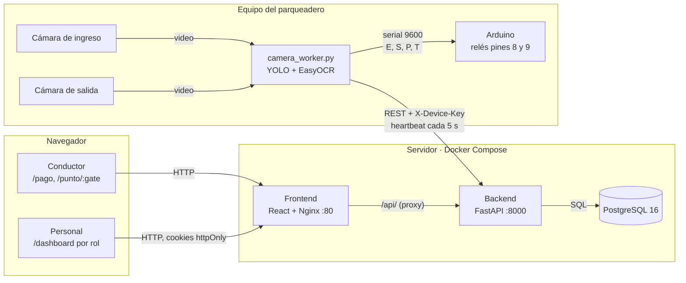
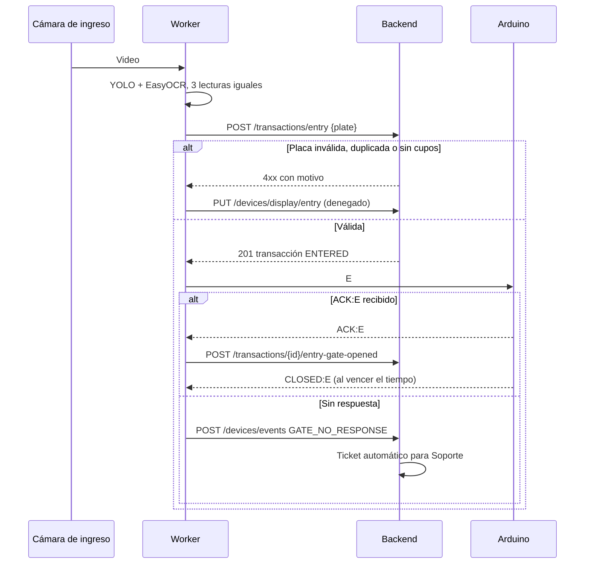
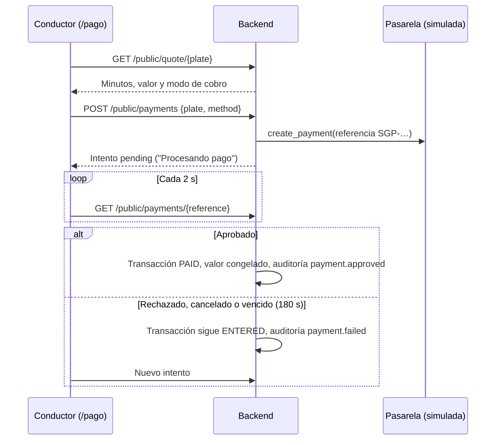
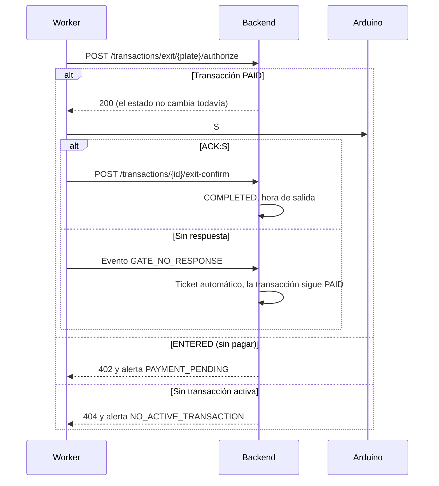
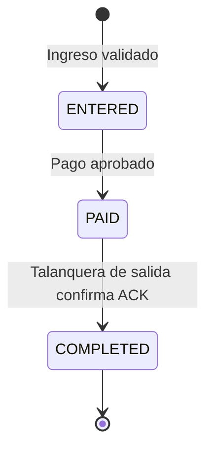
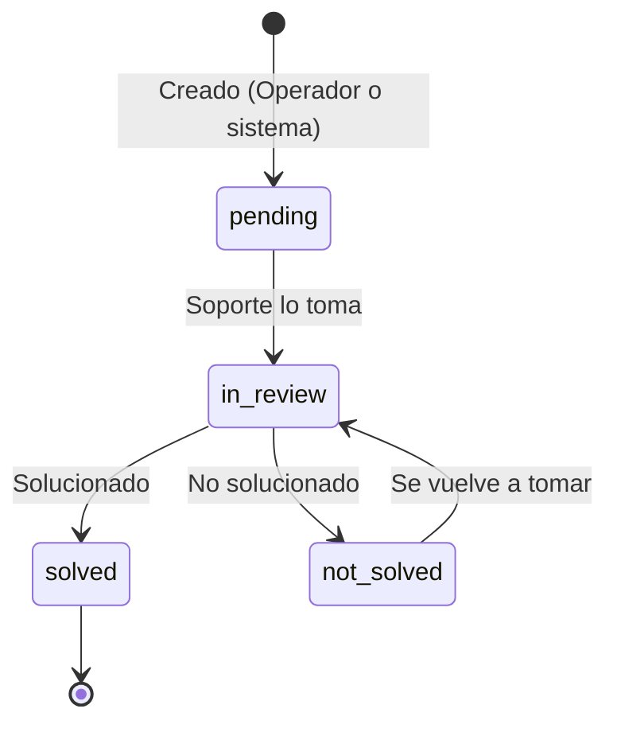

# 2. Documento de arquitectura

## 2.1 Visión general

SIGAP se reparte en dos equipos físicos:

- **Servidor.** Ejecuta en Docker Compose el frontend, el backend y la base de datos. Es el único que toma decisiones: cobra, autoriza aperturas, valida permisos y registra la auditoría.
- **Equipo del parqueadero.** Ejecuta el worker de cámaras (`backend/scripts/camera_worker.py`), que lee placas y controla el Arduino. El worker nunca decide por su cuenta: consulta al backend y ejecuta solo lo que este autoriza.

| Componente | Tecnología | Dónde corre | Responsabilidad |
| :--- | :--- | :--- | :--- |
| Frontend | React 19, React Router 8, Vite 8, Tailwind CSS 4 | Contenedor `frontend` (Nginx en producción) | Interfaz operativa pública y panel administrativo por rol |
| Backend | Python 3.12, FastAPI, SQLModel, Alembic | Contenedor `api`, puerto 8000 | Reglas de negocio, cobro, permisos, auditoría, tareas de fondo |
| Base de datos | PostgreSQL 16 Alpine | Contenedor `db`, puerto 5432 | Persistencia; inmutabilidad de históricos mediante triggers |
| Worker de cámaras | Python 3.12, Ultralytics YOLO, EasyOCR, OpenCV, pyserial | Equipo del parqueadero, con `uv` | Detección y lectura de placas, control de talanqueras, reporte de estado |
| Arduino | Sketch `sigap_talanquera.ino` | USB serial, 9600 baudios | Activa los relés de entrada (pin 8) y salida (pin 9) y confirma con `ACK` |

## 2.2 Arquitectura del backend

El backend aplica **arquitectura hexagonal (puertos y adaptadores)** organizada por módulos de dominio. Cada módulo de `backend/src/server/` tiene las mismas cuatro capas:

| Capa | Contenido | Depende de |
| :--- | :--- | :--- |
| `domain/` | Entidades, enums, errores de dominio e interfaces de repositorio (puertos) | Nada externo |
| `application/` | Servicios con los casos de uso (por ejemplo `TransactionService.register_entry`) | `domain/` |
| `infrastructure/` | Adaptadores concretos: repositorios PostgreSQL, pasarela simulada, reloj del sistema | `domain/` |
| `api/` | Routers FastAPI, esquemas de entrada y salida, dependencias de autenticación | `application/` |

La composición de servicios está centralizada en [`backend/src/server/wiring.py`](../backend/src/server/wiring.py). Ahí se elige, por ejemplo, la pasarela de pago según `PAYMENT_GATEWAY`. Para cambiar un adaptador (una pasarela real, otro motor de base de datos) basta con implementar el puerto y registrarlo en ese archivo; los casos de uso no cambian.

### Módulos

| Módulo | Responsabilidad | Historias de usuario |
| :--- | :--- | :--- |
| `auth` | Usuarios, roles, inicio y cierre de sesión, tokens, bloqueo por intentos | HU-15, HU-16, HU-17 |
| `parking` | Datos del parqueadero, capacidad, tiempo de apertura, ocupación | HU-02, HU-21 |
| `tariff` | Tarifas por tipo de vehículo, cálculo del cobro, histórico | HU-07, HU-13, HU-14 |
| `transaction` | Ingreso, salida, estados de la transacción, validación de placa | HU-01 a HU-05, HU-10 a HU-12, HU-18, HU-20 |
| `payment` | Cotización pública, intentos de pago, pasarela, vencimiento | HU-07, HU-08, HU-09 |
| `device` | Heartbeat, estado de dispositivos, eventos técnicos, órdenes de apertura, pantallas de carril | HU-05, HU-12, HU-22, HU-24 |
| `intervention` | Alertas operativas con foto, ingreso manual, corrección de placa, apertura de contingencia | HU-06, HU-11 |
| `ticket` | Tickets técnicos manuales y automáticos con historial | HU-23, HU-24, HU-25 |
| `audit` | Registro y consulta de la auditoría | HU-26, HU-27, HU-28 |
| `reporting` | Dashboard y recaudo | HU-19, HU-21 |
| `shared` | Errores comunes, rango de fechas, reloj, tipos SQL | — |

### Tareas de fondo

[`backend/src/server/lifespan.py`](../backend/src/server/lifespan.py) arranca dos ciclos al iniciar la API:

1. **Limpieza de tokens.** Borra los refresh tokens vencidos.
2. **Barrido operativo.** Marca como `no_communication` los dispositivos sin heartbeat durante más de `DEVICE_OFFLINE_SECONDS` (20 s) y abre un ticket automático. También vence los intentos de pago que superan `PAYMENT_TIMEOUT_SECONDS` (180 s).

## 2.3 Arquitectura del worker

| Archivo | Responsabilidad |
| :--- | :--- |
| `backend/scripts/camera_worker.py` | Bucle principal: captura de las dos cámaras, visión nocturna (corrección gamma), interfaz en pantalla, heartbeat |
| `backend/src/inference/detection.py` | Detección de la placa con YOLO (confianza mínima 0,20) |
| `backend/src/inference/plate_reader.py` | Lectura del texto con EasyOCR (confianza mínima 0,35) |
| `backend/src/processing/` | Preprocesamiento del recorte y corrección de caracteres confundibles (O/0, I/1…) |
| `backend/src/worker/gate_flow.py` | Flujo de cada carril: consultar al backend, abrir, confirmar o reportar el fallo |
| `backend/src/worker/gate_controller.py` | Protocolo serial con el Arduino, espera de `ACK`, reconexión |
| `backend/src/worker/backend_client.py` | Cliente HTTP del backend con reintentos |

Parámetros de lectura (`camera_worker.py`):

| Parámetro | Valor | Efecto |
| :--- | :--- | :--- |
| `REQUIRED_READINGS` | 3 | Lecturas iguales necesarias para confirmar una placa |
| `BUFFER_TIMEOUT` | 2,0 s | Tiempo máximo para acumular esas lecturas |
| `COOLDOWN_SECONDS` | 15 s | Pausa antes de volver a procesar la misma placa |
| `UNREADABLE_AFTER_SECONDS` | 4,0 s | Tiempo con placa detectada pero ilegible antes de crear la alerta |
| `UNREADABLE_COOLDOWN_SECONDS` | 30 s | Pausa entre alertas de placa ilegible |
| `HEARTBEAT_SECONDS` | 5 s | Frecuencia del reporte de estado al backend |

## 2.4 Flujos principales

### Ingreso (HU-01 a HU-05)

Si el worker reintenta el ingreso de una placa cuya talanquera nunca abrió, el backend devuelve la misma transacción con estado 200 en lugar de rechazarla por duplicada.

### Pago (HU-07 a HU-09)

### Salida (HU-10 a HU-12)

### Apertura manual de contingencia

El Operador o el Administrador solicita la apertura desde **Alertas e intervención** con un motivo obligatorio. El backend crea una orden en `gate_commands` con estado `pending`. El worker la recoge en su siguiente heartbeat, la ejecuta y reporta el resultado en `POST /devices/commands/{id}/result`. Las órdenes no recogidas vencen a los `GATE_COMMAND_TTL_SECONDS` (60 s). La apertura manual de salida también exige que la transacción esté `PAID`.

## 2.5 Estados

### Transacción

El valor cobrado, los minutos facturados y la configuración de la tarifa usada (`tariff_snapshot`) quedan guardados en la transacción al aprobarse el pago, así que un cambio de tarifa posterior no la afecta.

### Ticket técnico

Un ticket solucionado no se puede reabrir. Cada cambio de estado queda en `ticket_history`, que es inmutable.

## 2.6 Preparación para varias sedes

El documento V2.1 pide que el sistema pueda crecer a varias sedes sin reconstruirse. Para eso:

- Las tablas operativas (`transactions`, `tariffs`, `devices`, `gate_commands`, `operation_alerts`, `tickets`, entre otras) tienen la columna obligatoria `parking_lot_id`, con llave foránea a `parking_lots`.
- Las restricciones únicas incluyen la sede: `uq_tariff_lot_vehicle`, `uq_device_lot_code` y `uq_display_lot_gate`.
- Hoy los servicios trabajan con la sede por defecto (`00000000-0000-4000-8000-000000000001`) mediante `get_default()`. Para operar varias sedes falta identificar la sede en cada petición (por usuario o por dispositivo) y en el worker. El modelo de datos no necesita cambios.

## 2.7 Decisiones de diseño

| Decisión | Motivo |
| :--- | :--- |
| El backend decide y el worker ejecuta | Un equipo de patio comprometido no puede abrir la talanquera ni cambiar estados sin autorización del servidor |
| La salida pasa a `COMPLETED` solo después del `ACK` del Arduino | Si la talanquera falla, el conductor conserva su pago y puede salir cuando se repare (HU-12) |
| Pasarela detrás del puerto `PaymentGateway` | Permite simular pagos en la entrega y cambiar a una pasarela real sin tocar los casos de uso |
| Inmutabilidad con triggers de PostgreSQL | La protección no depende de la aplicación: ni un `UPDATE` directo en la base puede alterar la auditoría (HU-28) |
| Índice único parcial `uq_transactions_active_plate` | Garantiza en la base que no haya dos transacciones activas con la misma placa, incluso con peticiones simultáneas (HU-03) |
| Montos en `Numeric(12,2)` y `Decimal` | Evita errores de redondeo de los números de punto flotante en el cobro |
| Consulta periódica (polling) en lugar de WebSockets | Más simple de desplegar detrás de Nginx; los intervalos de 2 s y 5 s cumplen la actualización automática pedida |
