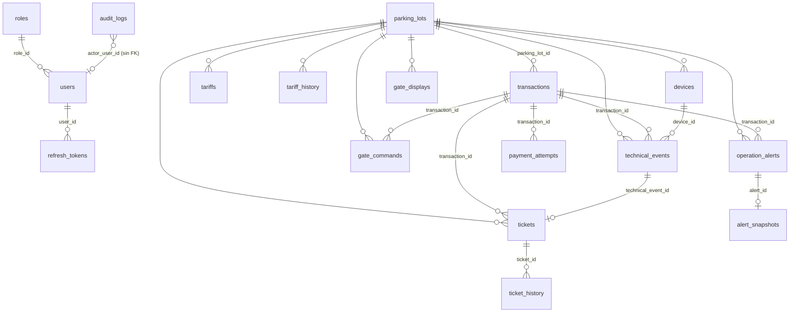

# 3. Modelo de datos

Motor: **PostgreSQL 16**. El esquema se versiona con **Alembic** en [`backend/migrations/versions/`](../backend/migrations/versions/):

| Revisión | Archivo | Contenido |
| :--- | :--- | :--- |
| `0001` | `0001_baseline.py` | Esquema inicial: `roles`, `users`, `refresh_tokens`, `transactions` |
| `0002` | `0002_parking_operations.py` | Operación según la V2.1: sedes, tarifas, pagos, dispositivos, alertas, tickets, auditoría y triggers de inmutabilidad |

[`backend/scripts/prestart.py`](../backend/scripts/prestart.py) aplica las migraciones y carga los datos iniciales antes de arrancar la API. Si encuentra una base creada antes de Alembic, la marca en la revisión `0001` y continúa desde ahí.

## 3.1 Diagrama entidad-relación



Los campos que guardan al usuario que hizo algo (`changed_by_id`, `created_by_id`, `requested_by_id`, `actor_user_id`…) **no tienen llave foránea a propósito** y vienen acompañados del nombre de usuario en texto (`changed_by_username`, `actor_label`…). Así los históricos inmutables conservan quién actuó aunque la cuenta cambie después.

## 3.2 Diccionario de datos

### Seguridad

**`roles`**

| Columna | Tipo | Nulo | Descripción |
| :--- | :--- | :--- | :--- |
| `id` | UUID | No | Llave primaria |
| `name` | varchar(255) | No | `admin`, `operator` o `support`. Único |
| `description` | varchar | Sí | Descripción del rol |

**`users`**

| Columna | Tipo | Nulo | Descripción |
| :--- | :--- | :--- | :--- |
| `id` | UUID | No | Llave primaria |
| `username` | varchar(20) | No | Nombre de usuario, de 3 a 20 caracteres. Único |
| `full_name` | varchar(80) | Sí | Nombre completo |
| `email` | varchar(120) | Sí | Correo electrónico |
| `is_active` | boolean | No | `false` impide iniciar sesión (HU-16) |
| `role_id` | UUID | Sí | FK a `roles` |
| `hashed_password` | varchar | No | Hash Argon2 de la contraseña |
| `must_change_password` | boolean | No | Obliga a cambiar la contraseña en el próximo ingreso |
| `password_changed_at` | timestamptz | Sí | Invalida los access tokens emitidos antes de esta fecha |
| `failed_login_attempts` | integer | No | Intentos fallidos consecutivos |
| `locked_until` | timestamptz | Sí | Fin del bloqueo temporal |
| `last_login` | timestamptz | Sí | Último inicio de sesión |
| `created_at`, `updated_at` | timestamptz | No | Fechas de control |

**`refresh_tokens`**

| Columna | Tipo | Nulo | Descripción |
| :--- | :--- | :--- | :--- |
| `id` | UUID | No | Llave primaria |
| `user_id` | UUID | No | FK a `users` |
| `family_id` | UUID | No | Agrupa los tokens de una misma sesión para detectar reutilización |
| `token_hash` | varchar(64) | No | SHA-256 del token; el token en claro nunca se guarda. Único |
| `expires_at` | timestamptz | No | Vencimiento del token (7 días) |
| `absolute_expires_at` | timestamptz | No | Vencimiento máximo de la sesión (15 días) |
| `revoked_at` | timestamptz | Sí | Fecha de revocación |
| `created_at` | timestamptz | No | Creación |

### Operación

**`parking_lots`**

| Columna | Tipo | Nulo | Descripción |
| :--- | :--- | :--- | :--- |
| `id` | UUID | No | Llave primaria. La sede por defecto es `00000000-0000-4000-8000-000000000001` |
| `name` | varchar(120) | No | Nombre de la sede |
| `address` | varchar(200) | Sí | Dirección |
| `capacity` | integer | No | Cupos totales (HU-02). Por defecto 50 |
| `gate_open_seconds` | integer | No | Segundos que la talanquera permanece abierta. Por defecto 3 |
| `created_at`, `updated_at` | timestamptz | No | Fechas de control |

**`transactions`**

| Columna | Tipo | Nulo | Descripción |
| :--- | :--- | :--- | :--- |
| `id` | UUID | No | Identificador del registro (HU-04) |
| `parking_lot_id` | UUID | No | FK a `parking_lots` |
| `plate` | varchar(10) | No | Placa normalizada (mayúsculas, sin espacios ni guiones) |
| `vehicle_type` | enum `vehicletype` | No | `CAR`, `MOTORCYCLE` (`UNKNOWN` no se acepta al registrar) |
| `status` | enum `transactionstatus` | No | `ENTERED`, `PAID`, `COMPLETED`. El valor `PROCESSING_PAYMENT` existe en el tipo por compatibilidad pero ya no se usa |
| `entry_time` | timestamptz | No | Hora de ingreso, tomada por el servidor (HU-04) |
| `entry_gate_opened_at` | timestamptz | Sí | Hora en que el Arduino confirmó la apertura de entrada |
| `billed_minutes` | integer | Sí | Minutos cobrados, fijados al aprobar el pago |
| `total_amount` | numeric(12,2) | Sí | Valor cobrado |
| `tariff_snapshot` | JSONB | Sí | Copia de la tarifa usada en el cobro |
| `payment_method` | varchar(50) | Sí | `card`, `pse` o `nequi` |
| `payment_reference` | varchar(100) | Sí | Referencia `SGP-…` del pago aprobado |
| `paid_at` | timestamptz | Sí | Hora de aprobación del pago (HU-08) |
| `exit_time` | timestamptz | Sí | Hora de salida (HU-12) |
| `manual_intervention` | boolean | No | Indica si hubo intervención manual (HU-20) |
| `manual_reason` | varchar(300) | Sí | Motivo de la intervención |
| `created_at`, `updated_at` | timestamptz | No | Fechas de control |

Índices relevantes: `uq_transactions_active_plate` (único parcial sobre `plate` cuando `status IN ('ENTERED','PAID')`, garantiza la HU-03), `ix_transactions_status`, `ix_transactions_entry_time`, `ix_transactions_paid_at`.

**`tariffs`**

| Columna | Tipo | Nulo | Descripción |
| :--- | :--- | :--- | :--- |
| `id` | UUID | No | Llave primaria |
| `parking_lot_id` | UUID | No | FK a `parking_lots` |
| `vehicle_type` | varchar(20) | No | `car` o `motorcycle`. Único por sede |
| `hourly_rate` | numeric(12,2) | No | Valor por hora |
| `fraction_rate` | numeric(12,2) | No | Valor por fracción |
| `fraction_minutes` | integer | No | Duración de la fracción en minutos |
| `full_rate` | numeric(12,2) | No | Tarifa plena por período de 12 horas |
| `full_rate_after_minutes` | integer | No | Límite a partir del cual se cobra tarifa plena. Por defecto 300 (5 h) |
| `updated_at` | timestamptz | No | Última modificación |

Valores iniciales cargados por [`seed.py`](../backend/src/server/seed.py) (el Administrador los ajusta desde la plataforma):

| Tipo | Hora | Fracción | Minutos de fracción | Tarifa plena |
| :--- | ---: | ---: | ---: | ---: |
| Carro | $4.000 | $2.000 | 30 | $20.000 |
| Moto | $2.000 | $1.000 | 30 | $10.000 |

**`tariff_history`** (inmutable)

| Columna | Tipo | Nulo | Descripción |
| :--- | :--- | :--- | :--- |
| `id` | UUID | No | Llave primaria |
| `parking_lot_id` | UUID | No | FK a `parking_lots` |
| `vehicle_type` | varchar(20) | No | Tipo de vehículo modificado |
| `previous_config` | JSONB | No | Configuración anterior (HU-14) |
| `new_config` | JSONB | No | Configuración nueva |
| `changed_by_id` | UUID | Sí | Usuario que hizo el cambio |
| `changed_by_username` | varchar(80) | No | Nombre de ese usuario |
| `changed_at` | timestamptz | No | Fecha y hora del cambio |

**`payment_attempts`**

| Columna | Tipo | Nulo | Descripción |
| :--- | :--- | :--- | :--- |
| `id` | UUID | No | Llave primaria |
| `transaction_id` | UUID | No | FK a `transactions` |
| `reference` | varchar(64) | No | Referencia `SGP-` + 24 caracteres aleatorios. Única |
| `gateway` | varchar(30) | No | Pasarela usada (`simulated`) |
| `method` | varchar(30) | No | Medio de pago |
| `amount` | numeric(12,2) | No | Valor cotizado al iniciar el intento |
| `billed_minutes` | integer | No | Minutos cotizados |
| `tariff_snapshot` | JSONB | No | Tarifa usada en la cotización |
| `status` | varchar(20) | No | `pending`, `approved`, `rejected`, `cancelled`, `expired` |
| `failure_reason` | varchar(200) | Sí | Motivo del fallo (HU-09) |
| `created_at` | timestamptz | No | Inicio del intento |
| `resolved_at` | timestamptz | Sí | Resolución |

### Dispositivos e intervención

**`devices`**

| Columna | Tipo | Nulo | Descripción |
| :--- | :--- | :--- | :--- |
| `id` | UUID | No | Llave primaria |
| `parking_lot_id` | UUID | No | FK a `parking_lots` |
| `code` | varchar(30) | No | `camera_entry`, `camera_exit`, `gate_entry`, `gate_exit`. Único por sede |
| `kind` | varchar(20) | No | `camera` o `gate` |
| `name` | varchar(80) | No | Nombre visible |
| `reported_status` | varchar(20) | No | `connected`, `no_communication`, `error` (HU-22) |
| `last_error` | varchar(300) | Sí | Último error reportado |
| `last_report_at` | timestamptz | Sí | Último heartbeat que incluyó este dispositivo |
| `last_seen_at` | timestamptz | Sí | Última comunicación correcta (HU-22) |

**`technical_events`**

| Columna | Tipo | Nulo | Descripción |
| :--- | :--- | :--- | :--- |
| `id` | UUID | No | Llave primaria |
| `parking_lot_id` | UUID | No | FK a `parking_lots` |
| `device_id` | UUID | Sí | FK a `devices` |
| `component` | varchar(80) | No | Componente afectado |
| `error_code` | varchar(40) | No | Por ejemplo `GATE_NO_RESPONSE`, `WORKER_NO_COMMUNICATION` |
| `description` | varchar(500) | No | Descripción del evento |
| `transaction_id` | UUID | Sí | Transacción relacionada |
| `created_at` | timestamptz | No | Fecha y hora |

**`gate_commands`** (órdenes de apertura manual)

| Columna | Tipo | Nulo | Descripción |
| :--- | :--- | :--- | :--- |
| `id` | UUID | No | Llave primaria |
| `parking_lot_id` | UUID | No | FK a `parking_lots` |
| `gate` | varchar(10) | No | `entry` o `exit` |
| `transaction_id` | UUID | Sí | Transacción asociada |
| `reason` | varchar(300) | No | Motivo obligatorio |
| `requested_by_id`, `requested_by_username` | UUID, varchar(80) | Sí, No | Quién la pidió |
| `status` | varchar(20) | No | `pending`, `sent`, `done`, `failed`, `expired` |
| `error` | varchar(300) | Sí | Error reportado por el worker |
| `created_at`, `completed_at` | timestamptz | No, Sí | Fechas |

**`gate_displays`**: mensaje que muestran las pantallas de carril `/punto/ingreso` y `/punto/salida`. Columnas: `gate`, `state` (`idle`, `validating`, `granted`, `denied`, `error`), `message`, `plate`, `expires_at`. Una fila por carril y sede.

**`operation_alerts`**

| Columna | Tipo | Nulo | Descripción |
| :--- | :--- | :--- | :--- |
| `id` | UUID | No | Llave primaria |
| `parking_lot_id` | UUID | No | FK a `parking_lots` |
| `gate` | varchar(10) | No | Carril de origen |
| `alert_type` | varchar(30) | No | `plate_unreadable`, `payment_pending`, `no_active_transaction` |
| `status` | varchar(20) | No | `pending`, `resolved`, `dismissed` |
| `plate_read` | varchar(10) | Sí | Lo que leyó la cámara |
| `message` | varchar(200) | No | Mensaje para el Operador |
| `has_snapshot` | boolean | No | Si existe foto en `alert_snapshots` |
| `transaction_id` | UUID | Sí | Transacción relacionada |
| `resolved_by_id`, `resolved_by_username` | UUID, varchar(80) | Sí | Quién la atendió |
| `resolution_note` | varchar(300) | Sí | Placa registrada o motivo del descarte |
| `created_at`, `resolved_at` | timestamptz | No, Sí | Fechas |

**`alert_snapshots`**: `alert_id` (PK y FK a `operation_alerts`) e `image` (bytea, JPEG de máximo 640 px de ancho).

### Tickets y auditoría

**`tickets`**

| Columna | Tipo | Nulo | Descripción |
| :--- | :--- | :--- | :--- |
| `id` | UUID | No | Llave primaria |
| `parking_lot_id` | UUID | No | FK a `parking_lots` |
| `origin` | varchar(20) | No | `manual` (Operador) o `automatic` (sistema) |
| `status` | varchar(20) | No | `pending`, `in_review`, `solved`, `not_solved` |
| `assigned_role` | varchar(20) | No | Siempre `support` (HU-23, HU-24) |
| `component` | varchar(80) | No | Componente o proceso afectado |
| `error_code` | varchar(40) | Sí | Código del evento técnico, si es automático |
| `description` | varchar(1000) | No | Descripción del problema |
| `transaction_id` | UUID | Sí | Transacción relacionada |
| `technical_event_id` | UUID | Sí | Evento técnico que lo originó |
| `created_by_id`, `created_by_username` | UUID, varchar(80) | Sí, No | Quién lo creó (`sistema` si es automático) |
| `assignee_id`, `assignee_username` | UUID, varchar(80) | Sí | Técnico que lo tomó |
| `diagnosis`, `actions_taken`, `result` | varchar(2000) | Sí | Registro de la atención (HU-25) |
| `created_at`, `updated_at` | timestamptz | No | Fechas |

**`ticket_history`** (inmutable): `ticket_id`, `from_status`, `to_status`, `user_id`, `username`, `note`, `created_at`.

**`audit_logs`** (inmutable)

| Columna | Tipo | Nulo | Descripción |
| :--- | :--- | :--- | :--- |
| `id` | UUID | No | Llave primaria |
| `actor_user_id` | UUID | Sí | Usuario que actuó; vacío si fue el sistema |
| `actor_label` | varchar(80) | No | Nombre del usuario o `sistema` |
| `action` | varchar(40) | No | Tipo de acción (ver tabla siguiente) |
| `entity_type` | varchar(40) | No | Tipo de elemento afectado |
| `entity_id` | varchar(64) | Sí | Identificador del elemento |
| `entity_label` | varchar(120) | Sí | Descripción legible (placa, usuario…) |
| `result` | varchar(10) | No | `success` o `failure` |
| `detail` | JSONB | No | Datos adicionales (medio, referencia, motivo…) |
| `created_at` | timestamptz | No | Fecha y hora |

Acciones auditadas (`AuditAction` en [`audit_log.py`](../backend/src/server/audit/domain/audit_log.py)):

| Acción | Cuándo |
| :--- | :--- |
| `transaction.created` | Ingreso registrado (automático o manual) |
| `transaction.completed` | Salida finalizada |
| `transaction.plate_corrected` | El Operador corrige la placa de un vehículo dentro |
| `payment.approved` / `payment.failed` | Pago aprobado / rechazado, cancelado o vencido |
| `gate.opened` / `gate.open_failed` / `gate.open_requested` | Apertura confirmada / fallida / solicitud manual |
| `tariff.updated` | Cambio de tarifa |
| `parking.updated` | Cambio de datos del parqueadero |
| `user.created` / `user.updated` / `user.password_reset` / `user.unlocked` | Gestión de cuentas |
| `auth.login` / `auth.logout` | Inicio y cierre de sesión (incluye intentos fallidos con `result = failure`) |
| `alert.resolved` / `alert.dismissed` | Atención de alertas |
| `ticket.created` / `ticket.status_changed` | Gestión de tickets |

## 3.3 Inmutabilidad

[`backend/core/immutable.py`](../backend/core/immutable.py) instala la función `sigap_reject_change()` y dos triggers por tabla sobre `audit_logs`, `tariff_history` y `ticket_history`:

- `trg_<tabla>_immutable`: `BEFORE UPDATE OR DELETE`, por fila.
- `trg_<tabla>_no_truncate`: `BEFORE TRUNCATE`, por sentencia.

Cualquier intento de modificar o borrar esos registros, incluso con SQL directo, termina con el error `Los registros de <tabla> son inmutables`. Las pruebas `test_database_rejects_changes_to_*` lo verifican.

## 3.4 Respaldo y restauración

Respaldo (desde el servidor de producción):

```bash
docker compose -f compose.prod.yml exec -T db pg_dump -U "$POSTGRES_USER" -d "$POSTGRES_DB" -Fc > sigap_$(date +%Y%m%d).dump
```

Restauración sobre una base vacía:

```bash
docker compose -f compose.prod.yml exec -T db pg_restore -U "$POSTGRES_USER" -d "$POSTGRES_DB" --clean --if-exists < sigap_20261120.dump
```

`pg_restore --clean` borra y vuelve a crear las tablas, así que pasa por encima de los triggers. Úselo solo para recuperar el sistema completo.
