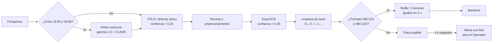

# 6. Modelo de visión (lectura de placas)

## 6.1 Proceso

La lectura de placas (HU-01, HU-10) combina dos modelos:

| Etapa | Archivo | Detalle |
| :--- | :--- | :--- |
| Visión nocturna | `scripts/camera_worker.py` (`apply_night_vision`) | Corrección gamma y ecualización en el espacio LAB, solo de noche |
| Detección | `src/inference/detection.py` | YOLO entrenado para una clase (`License Plate`); toma la caja de mayor confianza por encima de 0,20 |
| Preprocesamiento | `src/processing/preprocess_crop.py` | Prepara el recorte para el OCR |
| OCR | `src/inference/plate_reader.py` | EasyOCR en inglés, con GPU si está disponible; descarta textos con confianza menor a 0,35 |
| Limpieza | `src/processing/text_cleaner.py` | Corrige caracteres confundibles según la posición (letras en las 3 primeras, números en las siguientes) |
| Tipo de vehículo | `src/server/transaction/domain/plate.py` | `ABC123` es carro y `ABC12D` es moto (formato colombiano) |

Exigir 3 lecturas iguales antes de enviar la placa reduce los ingresos con lecturas erróneas: una lectura aislada mal hecha no alcanza a crear una transacción.

## 6.2 Entrenamiento

| Parámetro | Valor |
| :--- | :--- |
| Modelo base | YOLO26s preentrenado (`backend/src/training/pretrained_models/yolo26s.pt`) |
| Librería | Ultralytics 8.4.170 |
| Clases | 1: `License Plate` |
| Épocas | 300 (sin detención temprana) |
| Tamaño de imagen | 640 × 640 |
| Lote | 16 |
| Optimizador | `auto`, `lr0` = 0,01 |
| Aumentos de datos | HSV (h 0,015, s 0,7, v 0,4), rotación ±10°, traslación 0,1, escala 0,5, volteo horizontal 0,5 |
| Hardware | GPU (`device: 0`), precisión mixta |
| Duración | 31.062 s (unas 8,6 horas) |
| Fecha del modelo | 2 de octubre de 2026 |
| Script | [`backend/src/training/train/main.py`](../backend/src/training/train/main.py) |

El modelo en producción, `backend/models/YOLO/SIGAP_model_small_v1.pt`, es idéntico byte a byte a `best.pt` de esa corrida.

> **Diferencia a revisar:** `main.py` define `patience=25`, pero el `args.yaml` de la corrida registra `patience: 50`. La corrida entregada se hizo con un valor distinto al del script actual. No cambia los resultados (el entrenamiento llegó a las 300 épocas), pero conviene dejar el script igual a la corrida para que sea reproducible.

> **Pendiente de completar por el equipo:** el dataset (`backend/dataset/data.yaml`) no está en el repositorio. Para la entrega hay que documentar su origen, licencia, número de imágenes de entrenamiento, validación y prueba, y si incluye imágenes nocturnas y de motos.

## 6.3 Resultados

Métricas sobre el conjunto de validación en la última época (fuente: [`results.csv`](../backend/reports/runs/YOLO/yolo26s_detect/results.csv)):

| Métrica | Valor | Interpretación |
| :--- | ---: | :--- |
| Precisión | 0,988 | De cada 100 placas que el modelo detecta, cerca de 99 son placas reales |
| Exhaustividad (recall) | 0,960 | El modelo encuentra 96 de cada 100 placas presentes |
| mAP@0,5 | 0,974 | Muy buena localización con un criterio de solapamiento estándar |
| mAP@0,5:0,95 | 0,858 | Buena precisión de la caja incluso con criterios de solapamiento estrictos |

La mejor época por mAP@0,5:0,95 fue la 299 (0,8586), prácticamente igual a la última.

Gráficas incluidas en [`backend/reports/runs/YOLO/yolo26s_detect/`](../backend/reports/runs/YOLO/yolo26s_detect/):

| Archivo | Contenido |
| :--- | :--- |
| `results.png` | Pérdidas y métricas por época |
| `BoxPR_curve.png`, `BoxF1_curve.png`, `BoxP_curve.png`, `BoxR_curve.png` | Curvas precisión-exhaustividad, F1, precisión y exhaustividad según el umbral |
| `confusion_matrix.png`, `confusion_matrix_normalized.png` | Matriz de confusión placa / fondo |
| `val_batch*_labels.jpg` vs `val_batch*_pred.jpg` | Etiquetas reales frente a predicciones |

## 6.4 Alcance de estas métricas

- Miden **solo la detección** de la placa (YOLO). La exactitud del texto leído por EasyOCR no se midió con un conjunto etiquetado.
- Son métricas de validación, no de un conjunto de prueba separado ni de condiciones reales del parqueadero.

Para completar la evaluación se recomienda una **prueba de campo**: registrar al menos 100 pasos reales (de día, de noche, carros y motos) y anotar para cada uno si la placa se leyó bien al primer intento, si generó alerta de placa ilegible o si se leyó mal. La plantilla está en [08-pruebas.md](08-pruebas.md#85-prueba-de-campo-de-lectura-de-placas).
